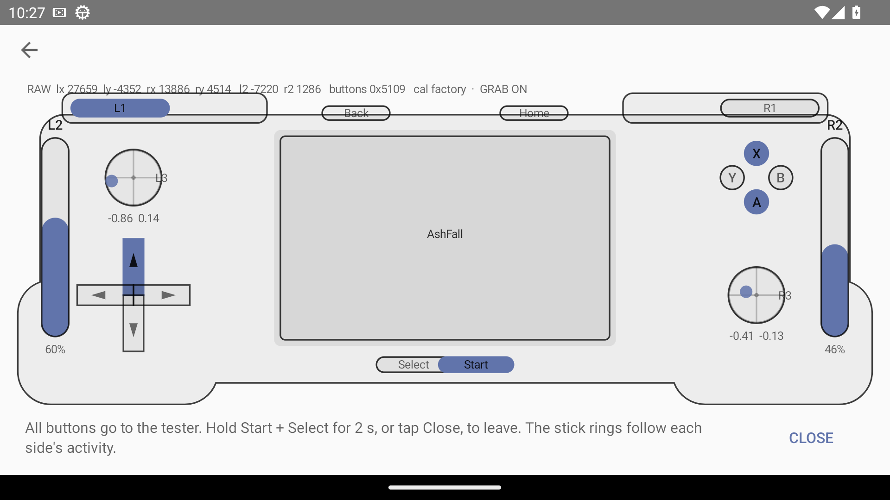
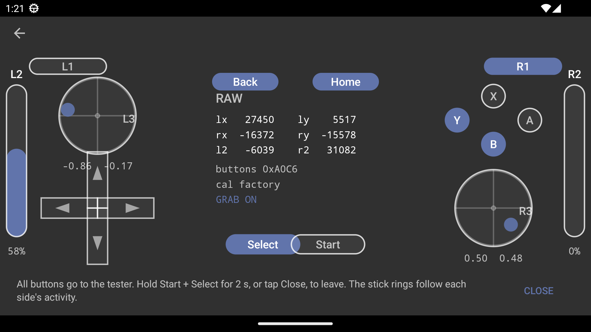

# AshFall Parts: controller tester and calibration wizard v2

Follow-ups to `docs/parts.md` for the user tests of 2026-11-14 (issues **#84**,
**#101**, **#103** and **#104**, contract `docs/phase5.md` §6.2/§6.3).  This page documents the
controller package only; the rest of AshFall Parts (root entry, fan, lighting,
QS tiles) is described in `docs/parts.md`.




## 1. What the tester does now

| User report | Change |
|---|---|
| 1. "Draw a proper RP5 silhouette" | First #84 added a clean-room RP5 body.  The retest (#101) removed the silhouette again: `ui/ControllerTesterView` now draws **only the controls** - sticks with inner/outer deadzone rings, a D-pad, the A/B/X/Y diamond, L1/R1, L2/R2 analog bars, Start/Select, Home/Back and L3/R3 - enlarged to use the whole landscape width (853 dp).  Every colour comes from `colorAccent`, `textColorPrimary` and `textColorSecondary`, so light, dark and LineageOS pure-black all follow the system theme. |
| 2. "X and Y appear swapped" / "A/B are swapped" | The drawing, not the daemon, was wrong (see §2).  #84 moved X to the top and Y to the left; #101 swapped the drawn A and B (A right, B bottom). |
| 3. "L2/R2 jump to 100 % at about half travel" | The old bar filled the whole trigger rect as soon as the analog value passed 0.5 (a drawing bug), and the view only saw `AXIS_*` values.  The tester now draws the exact analog value as a fill from the bottom and shows the percentage, computed from the raw MCU counts after calibration (so the number can be compared with the raw value). |
| 4. "B, Back, Home, Select don't show" | The tester now sends `GRAB ON` on its raw-stream socket (§3).  Nothing is injected into uinput, so every button is only reported in the `RAW` mask and drawn.  Leaving: hold **Start + Select for 2 s** (progress bar under the pills) or tap **Close**.  The old "Select toggles the raw overlay" mode is gone; the raw values are always visible. |
| 5. "Fun: light each side's LED ring with its activity" | `ashfall.ui.led_override` is published at <= 29 Hz (§4) and cleared on pause. |
| 6. "Calibration waits for Start" | The wizard's timed steps were replaced by Start-paced steps (§5). |
| 7. #104: "the app's D-pad is twice the editor's size" | `drawDpad` treated `r` as the offset to each arrow, so the total span was `4*r*H`; #104 changed it to `2*r*H`, and #105 rebuilt it as the four-pentagon 3x3 cross below (total `3*r*H`). |
| 8. #104: "ABXY distances are not equal" | The view is not 16:9, so scaling x by width and y by height made the diamond rectangular.  The group centre and a single pixel offset are computed from the four layout circles; X/Y/A/B are placed on a square diamond (distance X-B = Y-A = 2*off, diagonals off*sqrt(2)). |
| 9. #104: "L3/R3 labels" | The side label is gone; each stick has a capsule inside its top (0.9r x 0.34r) labelled L3/R3, accent-filled with the primary text colour while the stick is clicked. |
| 10. #104: "L2/R2 fill sticks out" | The fill is a plain rectangle from the bottom, clipped to the inner bar (2 dp inset): below 10 % it stays inside, any value > 0 keeps a 2 dp sliver, 0 % is empty, the outline is drawn on top. |
| 11. #105: "the direction rectangles overlap at the centre" | The D-pad is exactly four pentagons (`cell = r*h`, total `3*r*h`): each one is a 1x1 arm plus the triangular quarter of the 1x1 centre, so all four tips meet at the exact centre.  There is no separate centre rectangle; adjacent pentagons share only the diagonal seam edges, so pressing two shows two complete shapes and never one merged blob. |

## 2. The button layout

The physical RP5 diamond (confirmed in the user retests) is:

```
        X
    Y       A
        B
```

The MCU bits are fixed by `docs/rp5/input.md` and are **not** changed:

| MCU bit | stock key code | Key name | drawn at |
|---|---|---|---|
| 12 | `BTN_X` (0x133) | `BTN_NORTH` | top |
| 13 | `BTN_Y` (0x134) | `BTN_WEST` | left |
| 14 | `BTN_A` (0x130) | `BTN_SOUTH` | right |
| 15 | `BTN_B` (0x131) | `BTN_EAST` | bottom |

#84 moved X/Y to their real positions (the first drawing used the generic Xbox
arrangement); the retest showed that A/B were still swapped in the drawing, so
#101 swapped only the drawn positions of bits 14 and 15.  The daemon, the
`GRAB`/`RAW` protocol and the `SET CAL` format are untouched.

The controls follow the layout file: the left stick sits below the D-pad and the
right stick below the face buttons; Start/Select are large pills at the top
centre and Home/Back at the bottom centre.

## 3. GRAB lifecycle

`ipc/RawStream` now sends both commands on one connection:

```
RAW ON\n
GRAB ON\n
```

and reads the two replies (`OK`, or `ERR <reason>` -> `onGrabFailed`) with an
800 ms timeout, so a daemon that predates `GRAB` cannot block the tester.  While
grabbed:

* the daemon releases all held inputs and injects nothing into uinput;
* the tester's only input is the `RAW` frame (`lx ly rx ry l2 r2 buttons_hex`);
* `UI` key events do not arrive at all, which is the point: Home, Back and
  Select can be shown without the system consuming them first.

`onPause` sends `GRAB OFF`, then `RAW OFF`, and closes the socket; the daemon
also releases the grab when a client disconnects, so a crash cannot leave the
pad grabbed.  The activity is `KEEP_SCREEN_ON` for the duration.

If the socket or the daemon is unavailable the tester falls back to the ordinary
`KeyEvent`/`MotionEvent` path (plus B/Back to leave) and says so in the hint.

The on-screen **Close** button is the touch exit; with the pad grabbed the
gamepad cannot drive focus, so the Start+Select chord is the gamepad exit.  The
progress bar under the pills fills for 2 s and the activity finishes.

## 4. LED reaction

`ui/LedFeedback` writes

```
ashfall.ui.led_override = RRGGBB:RRGGBB      (left:right, empty = normal)
```

at most every 34 ms and only when the value changes.  Each side's level is the
maximum of that half's activity:

| side | inputs |
|---|---|
| left | left stick magnitude, L2, L1, L3, D-pad |
| right | right stick magnitude, R2, R1, R3, A/B/X/Y |
| both | Start/Select/Home/Back (0.55) |

The colour is the user's own `led.color_left`/`led.color_right` (falling back to
`FF2020`) scaled by `0.06 + 0.92 * activity` and by `led.brightness`; the idle
6 % glow shows which ring belongs to which side.  `clear()` writes an empty
value on pause/stop/destroy, which restores the normal lighting mode.

## 5. Calibration pacing

`CalibrationActivity` no longer uses 2/8/4-second timers.  Each step captures in
the background and ends when the user presses **Start** (the gamepad's
`KEYCODE_BUTTON_START`) or the on-screen Start button; the instructions, the
live sample count and the captured travel stay on screen for as long as needed:

1. **Let go of the sticks** - live sample count, Start when at rest.
2. **Roll both sticks around the edge** - live left/right travel, Start when
   done.  A quarter of the factory travel (or an absolute floor) is required,
   otherwise "Try again" appears; this rejects a short flick that would produce
   a skewed calibration.
3. **Pull both triggers fully** - live L2/R2 travel, same validation.
4. **Review and save** - unchanged: `SET CAL` with all 16 keys, Cancel leaves the
   file untouched.

The wizard never grabs the pad (Start must arrive as a normal key event), and B
still cancels.

## 6. Files

| file | change |
|---|---|
| `src/org/ashfall/parts/TesterActivity.java` | grab/raw lifecycle, 2 s Start+Select exit, close button, LED reaction, fallback input |
| `src/org/ashfall/parts/ui/ControllerTesterView.java` | controls-only drawing, mask-driven input, theme colours, exact trigger bars; all geometry from `TesterLayout` |
| `src/org/ashfall/parts/ui/TesterLayout.java` | loader/validator for `res/raw/tester_layout.json`, per-value fallbacks |
| `res/raw/tester_layout.json` | control geometry, owned by the temporary web layout editor |
| `tools/check_tester_layout.py` | host check: schema v1 keys and ranges |
| `src/org/ashfall/parts/ui/LedFeedback.java` | new: `ashfall.ui.led_override` publisher |
| `src/org/ashfall/parts/hw/PadState.java` | new: raw counts -> calibrated/deadzoned values on the app side |
| `src/org/ashfall/parts/ipc/RawStream.java` | `GRAB ON/OFF` on the raw connection, reply handling |
| `src/org/ashfall/parts/CalibrationActivity.java` | Start-paced steps, travel validation, readable live status |
| `src/org/ashfall/parts/ControllerActivity.java` | new tester/footer strings |
| `src/org/ashfall/parts/ui/StickPreviewView.java` | correct colour-state-list resolution in dark themes |
| `res/layout/activity_tester.xml` | hint + Close row |
| `res/layout/activity_calibration.xml` | larger, readable instructions, Start hint |
| `res/values/strings_controller.xml` | all new controller strings (kept out of `strings.xml`) |
| `tools/mock/AshfallMockDaemon.c` | test-only: `GRAB`, mask animation, Start+Select hold hook |
| `docs/parts/screenshots/tester*.png`, `calibration-*.png` | new emulator captures |

### 6.1 Live layout file (`res/raw/tester_layout.json`)

The tester's geometry is data, not code (issue #103), so the temporary web
layout editor can move controls without a code change.  The file is owned by the
editor/user; the app only reads it.

Schema v1 (all values are floats, sizes relative to the view):

```json
{
  "version": 1,
  "controls": {
    "left_stick": {"x": 0.165, "y": 0.708271, "r": 0.175},
    "right_stick": {"x": 0.835, "y": 0.72, "r": 0.175},
    "dpad": {"x": 0.17631, "y": 0.314459, "r": 0.128},
    "button_x": {"x": 0.835, "y": 0.2107, "r": 0.0533},
    "button_y": {"x": 0.7735, "y": 0.32, "r": 0.0533},
    "button_a": {"x": 0.8965, "y": 0.32, "r": 0.0533},
    "button_b": {"x": 0.835, "y": 0.4293, "r": 0.0533},
    "l1": {"x": 0.115, "y": 0.075, "w": 0.13, "h": 0.072},
    "r1": {"x": 0.885, "y": 0.075, "w": 0.13, "h": 0.072},
    "l2": {"x": 0.028, "y": 0.505, "w": 0.0339, "h": 0.69},
    "r2": {"x": 0.972, "y": 0.505, "w": 0.0339, "h": 0.69},
    "back": {"x": 0.6, "y": 0.885, "w": 0.11, "h": 0.074},
    "home": {"x": 0.4, "y": 0.885, "w": 0.11, "h": 0.074},
    "select": {"x": 0.4, "y": 0.145, "w": 0.124, "h": 0.086},
    "start": {"x": 0.6, "y": 0.145, "w": 0.124, "h": 0.086},
    "status": {"x": 0.365, "y": 0.3}
  }
}
```

* `x`/`y` are the control's centre as a fraction of the view width/height.
* Circles (`left_stick`, `right_stick`, `dpad`, `button_x/y/a/b`) use `r`, a
  fraction of the view height.  For the D-pad `r` is **one cell of the 3x3
  cross** (the total span is `3*r*H`, the centre square is `r*H` square).  The four face-button circles only define
  the diamond's centre and one common pixel offset; the app keeps the diamond
  square on the non-16:9 tester view, so their exact per-axis positions are not
  honoured (each button keeps its own `r`).
* The shipped `res/raw/tester_layout.json`, not this example, is the source of
  truth; the values above are the last save applied for testing.
* Rectangles (`l1`, `r1`, `l2`, `r2`, `back`, `home`, `select`, `start`) use the
  full `w` (fraction of width) and `h` (fraction of height), centred on `x`/`y`.
  L2/R2 are drawn as vertical bars whose fill is the exact analog value.
* `status` is the origin of the RAW/calibration/GRAB text block.

`TesterLayout.load()` reads `R.raw.tester_layout` and validates every field:
missing, non-numeric or out-of-range values fall back to the built-in defaults
for that field; an unknown `version`, unreadable resource or malformed JSON falls
back to the full defaults.  Nothing throws, so a bad save from the editor can
never crash the tester.  Falling back is logged (`AshFallParts` tag).

Before building a layout, run the host check (it is stricter than the app - it
fails instead of falling back):

```sh
aosp/vendor/ashfall/apps/AshFallParts/tools/check_tester_layout.py
# or: tools/check_tester_layout.py path/to/tester_layout.json
```

## 7. Verification

Emulator preview (Android 13, 1920x1080, density 360), same sources as the
Soong module:

* `preview/prepare.sh && gradle :app:assembleDebug` -> BUILD SUCCESSFUL.
* `tools/check_tester_layout.py` -> `ok (schema v1, 16 controls)` for the shipped
  file; a mutated copy (`version` 2, `r` 1.5, missing `start.h`, `dpad.x` -0.2)
  -> four errors, exit 1.
* Loader fallback, host JVM check of `TesterLayout.parse` (org.json, Android
  `Log` stubbed): full valid file -> values used; partial file with an invalid
  `button_x.r` and a missing `l1.h` -> per-value defaults; out-of-range
  (`x` -1/`y` 2/`r` 0/`h` 1.5) -> defaults; `version` 2, broken JSON, empty and
  null -> full defaults.  All assertions passed (exit 0) and the expected
  warnings were logged.
* Emulator: with the shipped layout every control landed on its schema position
  (measured from the accent fills and ring edges).  A test layout copied into
  the *preview build output* (never the owned file) moved the left stick to
  0.5/0.5, X to 0.5/0.2 with `r` invalid and L1 to 0.5/0.1 with `h` missing:
  only those positions moved, `r`/`h` fell back to the defaults and all other
  controls stayed at the schema defaults.  Replacing it with `{ this is not
  json` logged `tester layout: invalid JSON, using defaults` and drew the full
  defaults - no crash.  The shipped file was not modified by any of this.
* Mock daemon: `tools/mock/build.sh --run` (test-only, never installed in the
  image) with `setenforce 0` (the debug APK cannot write properties as a
  user build, the same limitation documented in `docs/parts.md` §6.2).
* The tester connected with `GRAB ON` (mock log), streamed `RAW` frames, and the
  view's accessibility state tracked them:
  `Left -0.85 0.20, right -0.15 0.57, L2 0.13, R2 0.43, raw lx 27277 ...,
  buttons 0x0430, pressed L3 R3 Left`.  The calibrated values were recomputed by
  hand from the raw counts and the factory calibration (deadzone 5 %, outer 3 %,
  trigger 3 %) and match.
* Button positions were checked on screenshots by locating the accent-coloured
  fills: with the mock reporting `Y B R1 Select Home Back`, exactly those six
  shapes are lit, Y is **left** of the face centre and B is **below** it; with
  `X A L1 Start Up` exactly those shapes are lit, X **top** and A **right**.
  D-pad, L3/R3 rings and both trigger bars matched the reported values (e.g.
  `L2 0.57` -> bar fill 0.57 of its height), and the control sizes were measured
  on the 1920x715 px view: sticks 250 px (111 dp) diameter, face buttons
  82 px (36 dp), D-pad 186 px across, Start/Select 238x61 px - roughly double
  the first version.
* `getprop ashfall.ui.led_override` while the tester was open:
  `871111:831010`, later `8B1111:8B1111` (per-side activity), and empty after
  closing the tester with the on-screen Close button.  Closing also logged
  `GRAB OFF` on the mock.
* Start+Select exit: the mock's hold hook reported both buttons; the tester
  finished after 2 s (progress bar), logged `GRAB OFF`, and the LED override was
  cleared.
* Calibration: with Start no longer on a timer, step 1 stayed on screen for
  minutes with growing sample counts; a quick Start in step 2 produced
  "The sticks did not move far enough. ... Try again", a full roll passed,
  step 3 validated the trigger travel, and step 4 showed the 16 values with
  Save/Cancel.
* Light and dark: the controls, labels and accent were resolved through the
  theme (`?android:attr/colorBackground`: `#FAFAFA` light, `#303030` in this
  AVD's dark theme; pure black uses the same attributes), outlines and fills
  visible in both.
* #104 geometry (emulator, shipped layout): X/B are 197 px apart vertically and
  Y/A 196 px horizontally, with diagonals 138 px = 98*sqrt(2) (square diamond,
  `off` 98.1); the L3/R3 caps are 116x46 px at `cy - 0.55r` and fill with the
  accent when THUMBL/THUMBR is pressed, with no side label; a 0 % trigger is
  empty, 34 % and 59 % fills stay inside the 4.5 px (2 dp) inset bar with a
  straight top edge; Select/Start render in the top row (`y` 0.145) and
  Home/Back in the bottom row (`y` 0.885) with their labels.
* #105 D-pad (emulator, shipped layout, mock holding Up+Left): one cell is
  91.5 px, so the four-pentagon plus spans 199..477 px horizontally and
  247..525 px vertically (3*91.5 px plus the 2 dp outlines).  The plus is
  exactly four pentagons - one 1x1 arm plus a triangular quarter of the 1x1
  centre each - and the four tips meet at the exact centre `(cx, cy)`; there is
  no separate centre rectangle.  Measured on the up arm: 96 px wide (the full
  cell) from the outer base y 249 to y 341 (half a cell out), then
  91->81->71->61->51->41->31->21->11 px at y 344/349/354/359/364/369/374/379/384,
  i.e. the tip reaches the centre at y 387; the left arm mirrors it (96 px tall
  at its base, tip at the centre).  Pressed = accent fill/stroke, neutral =
  subtle fill/stroke.  With Up+Left held the accent mask matches the two
  pentagons (IoU 0.944 against the 2 dp accent stroke, 2 missing pixels), the
  centre is accent, and the right/down arms contain zero accent pixels.  The
  four shared tips are drawn as seams with opaque colours, because four
  translucent strokes stacked into a dark dot at the centre; the centre now
  matches the seam colour (81 light / 193 dark on the neutral D-pad).
  **Collision check against the saved layout:** the left stick clears the
  D-pad by 19 px at the emulator's 715 px view height (0.0268h; 25 px at the
  device's ~930 px).  L1's bottom edge is 8.2 px (0.0115h; 10.7 px at 930)
  above the D-pad's top tip, so both the fills and the 2 dp outlines clear.
  Nothing moved (the layout's `dpad.y` is the orchestrator's 037ff2f nudge to
  0.314459).  Screenshots refreshed (light: X/A with the Up pentagon, tip at the
  centre; dark: Y/B, Select top, Home/Back bottom).

Not verified here: the RP5 hardware itself (owned by the native worker, and the
device is serialised between workers).  The device checks to repeat are the real
Start+Select chord, the LED override on the real rings (`ashfall-hwd` is the
writer), and a full-circle calibration with the sticks at rest.

## 8. Cross-worker contract notes (native #82)

* The tester depends on the documented 16-bit `RAW` mask (bit order unchanged):
  `15 B, 14 A, 13 Y, 12 X, 11 right, 10 left, 9 down, 8 up, 7 back, 6 home,
  5 R3, 4 L3, 3 start, 2 select, 1 R1, 0 L1`.  If the mask changes, this page and
  `ControllerTesterView.BTN_*` must change with it.
* `GRAB ON`/`GRAB OFF` must be accepted on the same connection that asked for
  `RAW ON`, and `GRAB` must end on disconnect (contract §6.2).  An `ERR` reply
  is shown to the user as "Button capture failed; Home, Back and Select may
  still reach the system."
* `ashfall.ui.led_override` is written at <= 29 Hz as `RRGGBB:RRGGBB` and cleared
  with an empty value; the daemon must treat empty as "normal lighting".
* Triggers are displayed from the raw counts with `(max - raw) / (max - min)`,
  so a 50 % pull must be reported as 50 % in the mask's analog values, not
  snapped.
